   

<!-- Profile README for github.com/yveskwameh. Images are built by src/build.py, in a dark and a light version each. -->

<a href="https://yveskwameh.com"><picture><source media="(prefers-color-scheme: dark)" srcset="assets/hero-dark.svg"><source media="(prefers-color-scheme: light)" srcset="assets/hero-light.svg"></picture></a>

  <a href="https://yveskwameh.com">yveskwameh.com</a>&nbsp;&nbsp;·&nbsp;&nbsp;
  <a href="https://www.linkedin.com/in/yveskwameh/">LinkedIn</a>&nbsp;&nbsp;·&nbsp;&nbsp;
  <a href="https://x.com/yveskwameh">X</a>&nbsp;&nbsp;·&nbsp;&nbsp;
  <a href="mailto:hello@yveskwameh.com">hello@yveskwameh.com</a>

Design engineer. I design interfaces in Figma and build them in Webflow, Framer, Astro, NextJs, React and React Native. Open to full-time design engineer roles.

  

<picture><source media="(prefers-color-scheme: dark)" srcset="assets/statement-dark.svg"><source media="(prefers-color-scheme: light)" srcset="assets/statement-light.svg"></picture>

  

<picture><source media="(prefers-color-scheme: dark)" srcset="assets/h-products-dark.svg"><source media="(prefers-color-scheme: light)" srcset="assets/h-products-light.svg"></picture>

  <a href="https://daraxando.yveskwameh.com"><picture><source media="(prefers-color-scheme: dark)" srcset="assets/card-daraxando-dark.svg"><source media="(prefers-color-scheme: light)" srcset="assets/card-daraxando-light.svg"></picture></a>
  <a href="https://pennivault.xyz"><picture><source media="(prefers-color-scheme: dark)" srcset="assets/card-pennivault-dark.svg"><source media="(prefers-color-scheme: light)" srcset="assets/card-pennivault-light.svg"></picture></a>

<a href="https://github.com/yveskwameh/daraxando"><picture><source media="(prefers-color-scheme: dark)" srcset="assets/spec-daraxando-dark.svg"><source media="(prefers-color-scheme: light)" srcset="assets/spec-daraxando-light.svg"></picture></a>

  

<a href="https://pennivault.xyz"><picture><source media="(prefers-color-scheme: dark)" srcset="assets/spec-pennivault-dark.svg"><source media="(prefers-color-scheme: light)" srcset="assets/spec-pennivault-light.svg"></picture></a>

  

<a href="https://yveskwameh.com"><picture><source media="(prefers-color-scheme: dark)" srcset="assets/card-yvesos-dark.svg"><source media="(prefers-color-scheme: light)" srcset="assets/card-yvesos-light.svg"></picture></a>

<a href="https://github.com/yveskwameh/yveskwameh-2026"><picture><source media="(prefers-color-scheme: dark)" srcset="assets/spec-yvesos-dark.svg"><source media="(prefers-color-scheme: light)" srcset="assets/spec-yvesos-light.svg"></picture></a>

  

<picture><source media="(prefers-color-scheme: dark)" srcset="assets/chapters-dark.svg"><source media="(prefers-color-scheme: light)" srcset="assets/chapters-light.svg"></picture>

  

<a href="https://yveskwameh.com"><picture><source media="(prefers-color-scheme: dark)" srcset="assets/clients-dark.svg"><source media="(prefers-color-scheme: light)" srcset="assets/clients-light.svg"></picture></a>

  

<picture><source media="(prefers-color-scheme: dark)" srcset="assets/process-dark.svg"><source media="(prefers-color-scheme: light)" srcset="assets/process-light.svg"></picture>

  

<a href="mailto:hello@yveskwameh.com"><picture><source media="(prefers-color-scheme: dark)" srcset="assets/footer-dark.svg"><source media="(prefers-color-scheme: light)" srcset="assets/footer-light.svg"></picture></a>

  <a href="https://yveskwameh.com">yveskwameh.com</a>&nbsp;&nbsp;·&nbsp;&nbsp;
  <a href="https://www.linkedin.com/in/yveskwameh/">LinkedIn</a>&nbsp;&nbsp;·&nbsp;&nbsp;
  <a href="https://x.com/yveskwameh">X</a>&nbsp;&nbsp;·&nbsp;&nbsp;
  <a href="https://www.instagram.com/yveskwameh/">Instagram</a>

